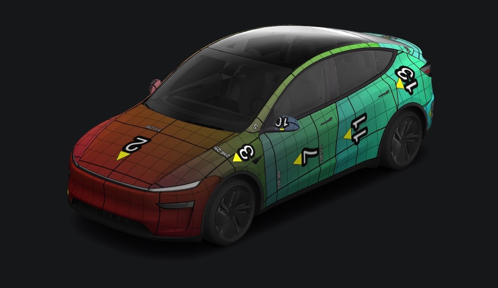
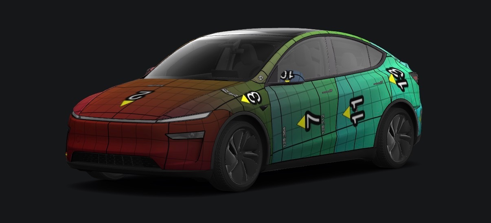
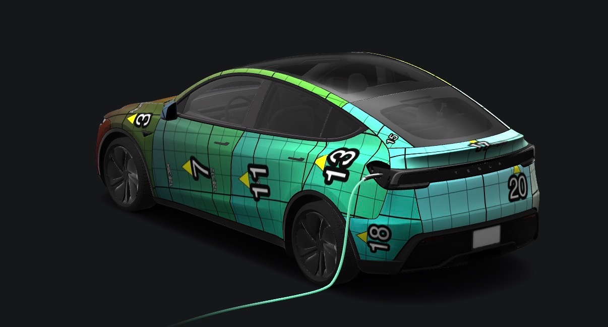
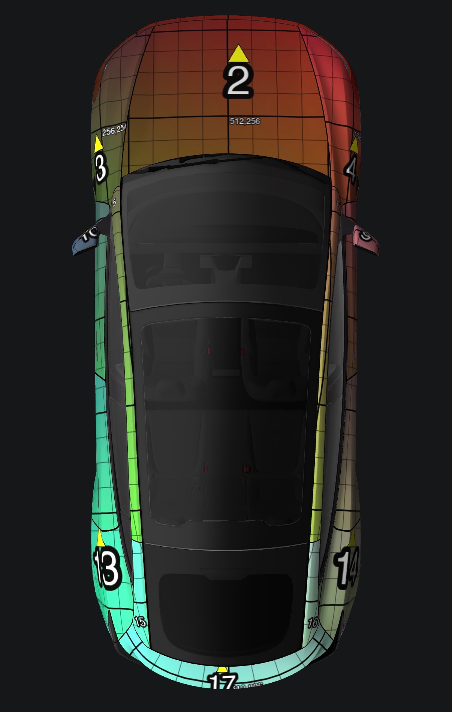

# create-tesla-wrap

An agent skill that creates and edits custom Tesla Paint Shop wraps. It builds artwork inside the official template masks, places it using each panel's real-world orientation, and checks that the result is a valid 1024 × 1024 PNG under 1 MB.

It defaults to the **Model Y 2025 Premium** template. The bundled panel map, assets, and validator apply only to that vehicle.

## Install

The skill's folder name should be `create-tesla-wrap`, so clone the repo into a skills directory under that name.

### Claude Code

Personal install, available in every project:

```bash
git clone https://github.com/tyleraspencer/tesla-wrap-skill ~/.claude/skills/create-tesla-wrap
```

Or project-only, from inside your project:

```bash
git clone https://github.com/tyleraspencer/tesla-wrap-skill .claude/skills/create-tesla-wrap
```

Restart Claude Code (or start a new session) so it picks up the skill.

### Codex / other agents

`agents/openai.yaml` carries the metadata for OpenAI-based agents. Clone the repo into that agent's skills directory (for Codex, typically `~/.codex/skills/create-tesla-wrap`).

### Python dependencies

The validator, `scripts/check_wrap.py`, needs:

```bash
pip install pillow numpy scipy
```

## Use

Ask your agent for a wrap, or invoke the skill by name:

> Use create-tesla-wrap to make a matte black wrap with thin white racing stripes.

The skill returns a single verified PNG. It is exactly 1024 × 1024, strictly under 1,000,000 bytes, with a filename of 1–30 letters, digits, underscores, hyphens or spaces.

## Validate a wrap yourself

```bash
python scripts/check_wrap.py my_wrap.png --template assets/modely-2025-premium-template.png
```

## Calibration photos

The skill's seam reference ([references/seam-adjacency.md](references/seam-adjacency.md)) comes from these Tesla app 3D previews of a position-coded test texture ([`Calibration_Grid.png`](references/calibration-photos/Calibration_Grid.png)). Each panel shows its ID and a yellow arrow pointing toward the top of the canvas.

| Front-left, raised | Front-left, low |
| --- | --- |
|  |  |
| **Rear-left** | **Top-down** |
|  |  |

## Contents

| Path | Purpose |
| --- | --- |
| `SKILL.md` | The skill instructions and workflow |
| `references/panel-orientation.md` | Panel identities, orientation, and ground-facing edges |
| `references/calibration-photos/` | Photos and test texture behind the seam reference |
| `references/seam-adjacency.md` | On-car seam adjacency and continuity from calibration photos |
| `references/panel-map.json` | Machine-readable panel geometry and template fingerprint |
| `references/ground-edge-reference.png` | Visual guide to ground-facing edges |
| `assets/modely-2025-premium-template.png` | Official template (kept untouched) |
| `assets/modely-2025-premium-panel-ids.png` | Map of all 20 panel islands |
| `scripts/check_wrap.py` | PNG and template-geometry validator |

## Source

The template comes from Tesla's official [custom-wraps](https://github.com/teslamotors/custom-wraps) repository.
